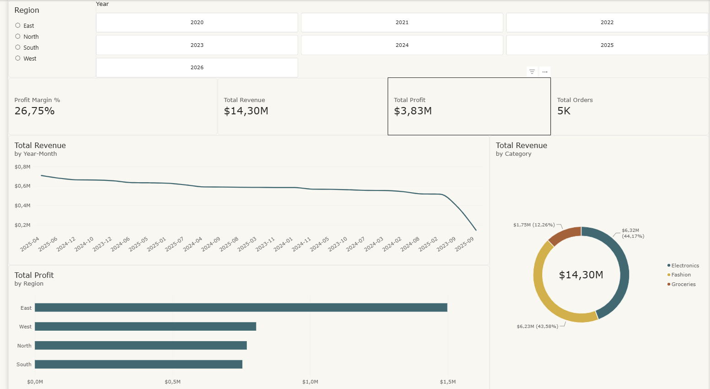

# 🇿🇦 MzansiRetail Analytics Engine

[](https://app.powerbi.com/view?r=eyJrIjoiNTk1N2ZkMjktM2NlMi00NTdiLTg3NDEtZGY1MjM2YzVlNTliIiwidCI6IjMyZWIxYjBhLWMwMmItNDBjNC04MzNiLTU4MjMxNWFiOTMzNiJ9)

## 📌 Project Overview
**MzansiRetail Analytics Engine** is an enterprise-grade, end-to-end data engineering portfolio project built by **AnalyticalBeak**. It showcases a professional data architecture spanning a Python automated ETL pipeline, a PostgreSQL data warehouse (`retail_analytics_db`), advanced SQL analytical views, and an executive-level Power BI report tailored to the South African retail market.

👉 **[Click Here to Launch Full-Screen Interactive MzansiRetail Dashboard](https://app.powerbi.com/view?r=eyJrIjoiNTk1N2ZkMjktM2NlMi00NTdiLTg3NDEtZGY1MjM2YzVlNTliIiwidCI6IjMyZWIxYjBhLWMwMmItNDBjNC04MzNiLTU4MjMxNWFiOTMzNiJ9)**

---

## 📸 Dashboard Preview



---

## 🛠️ Data Architecture & Engineering Pipeline

### 1. Python ETL & PostgreSQL Data Warehouse (`retail_analytics_db`)
- **Python Automation (`etl_pipeline.py`):** Configured with robust authentication and mock data generation to seed relational tables.
- **Star Schema Relational Tables:** Fully populated relational core featuring 6 core tables (`Transactions`, `Customers`, `Products`, `Stores`, and dynamic date/calendar dimensions).
- **Advanced SQL Views (`analytics_views.sql`):** Engineered custom PostgreSQL analytical views:
  - `vw_customer_rfm`: Computes Recency, Frequency, and Monetary scores to segment South African consumer behavior.
  - `vw_store_sales_performance`: Aggregates regional performance across local storefronts and provinces (Gauteng, Western Cape, KwaZulu-Natal).

### 2. Star Schema Data Model (Power BI Desktop)
High-performance Star Schema data model utilizing a $1:*$ relationship strategy connecting dimension tables to the central fact table:
- `Transactions` (Fact Table)
- `Customers` (Dimension Table via `CustomerID`)
- `Products` (Dimension Table via `ProductID`)
- `Stores` (Dimension Table via `StoreID`)
- `Dim_Date` (Dimension Table via `Date`)

---

## 🧮 Key DAX Measures Created

To analyze the business process without affecting data storage performance, all key business metrics were calculated using explicit DAX measures stored in a dedicated `_Measures` table:

```dax
-- 1. Total Revenue
Total Revenue = 
SUMX(
    Transactions,
    Transactions[Quantity] * RELATED(Products[UnitPrice]) * (1 - Transactions[Discount])
)
```

```dax
-- 2. Total Cost
Total Cost = 
SUMX(
    Transactions,
    Transactions[Quantity] * RELATED(Products[CostPrice])
)
```

```dax
-- 3. Total Profit
Total Profit = [Total Revenue] - [Total Cost]
```

```dax
-- 4. Profit Margin %
Profit Margin % = 
DIVIDE([Total Profit], [Total Revenue], 0)
```

```dax
-- 5. Total Orders
Total Orders = DISTINCTCOUNT(Transactions[TransactionID])
```
